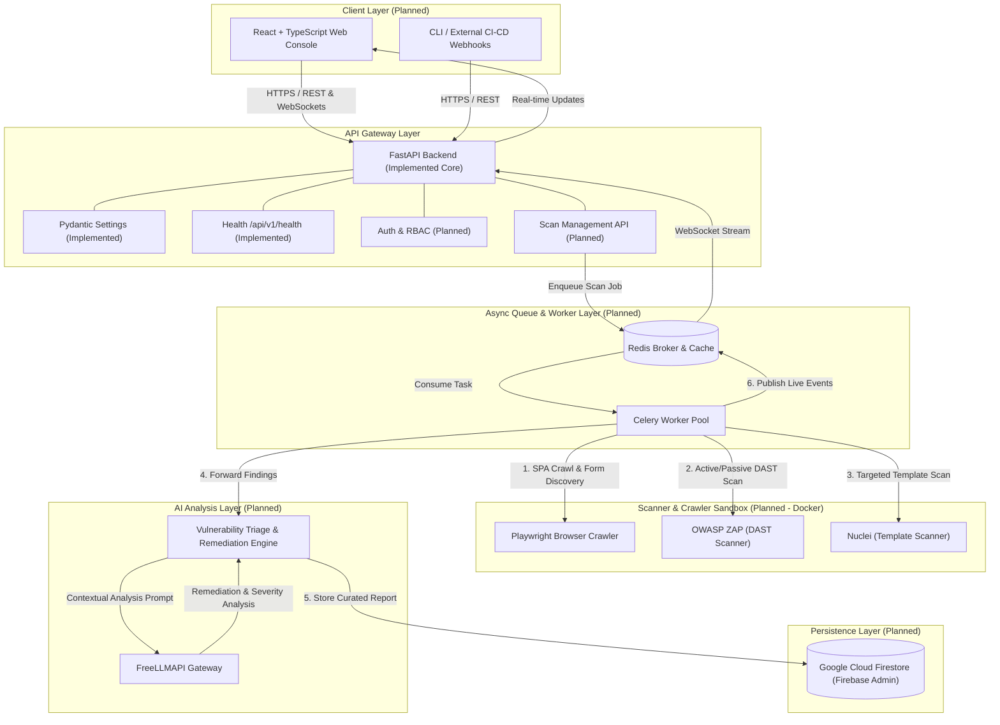

# Kavach Architecture & System Design

This document details the planned architecture, subsystem responsibilities, and scanning lifecycle for **Kavach**, an AI-assisted application security testing platform.

> [!NOTE]
> **Implementation Status**: Only the **FastAPI Core Foundation (Day 1)** is currently implemented. All other components (Firestore, Redis, Celery, Playwright, ZAP, Nuclei, FreeLLMAPI, React UI, Docker sandbox) are **planned** for subsequent milestones.

---

## 1. High-Level System Architecture

The following diagram illustrates the planned interactions between clients, the API gateway, distributed task workers, security scanning engines, LLM routing, and persistent storage:



---

## 2. Component Responsibilities

### 2.1 Backend API Gateway (`FastAPI`)
- **Status**: **Implemented (Core Foundation)**
- **Responsibilities**:
  - Serves as the primary REST and WebSocket entry point.
  - Enforces route versioning (`/api/v1`) and validates request/response payloads with Pydantic.
  - Exposes interactive OpenAPI documentation (`/docs`, `/redoc`).
  - Manages target registration, scan configuration, and execution requests.
  - Authenticates users and enforces role-based access control (RBAC).

### 2.2 Configuration Management (`pydantic-settings`)
- **Status**: **Implemented**
- **Responsibilities**:
  - Parses configuration from environment variables and `.env` files.
  - Enforces typed parameters for application ports, hosts, logging, and routing prefixes.
  - Ensures safe defaults for local development without hardcoded secrets.

### 2.3 Cloud Persistence (`Google Cloud Firestore & Firebase Admin SDK`)
- **Status**: *Planned (Phase 2)*
- **Responsibilities**:
  - Stores scan target configurations, scheduling rules, and credentials.
  - Records vulnerability findings, severity levels, CVSS metrics, and reproduction steps.
  - Manages audit logs, execution timelines, and user profile data.
  - Utilizes Firebase Admin SDK for administrative operations and server-side authentication.

### 2.4 AI Routing & Triage (`FreeLLMAPI`)
- **Status**: *Planned (Phase 5)*
- **Responsibilities**:
  - Routes vulnerability findings through LLMs for contextual risk analysis.
  - Filters out scanner false-positives by analyzing HTTP request/response pairs and DOM state.
  - Synthesizes actionable developer remediation guides and secure code snippets.
  - Dynamically selects optimal open LLM endpoints based on task complexity.

### 2.5 Headless Browser Automation (`Playwright`)
- **Status**: *Planned (Phase 4)*
- **Responsibilities**:
  - Crawls Single-Page Applications (React, Vue, Angular) that traditional HTTP spiders miss.
  - Executes authenticated login sequences and handles multi-step forms.
  - Extracts active API endpoints, hidden DOM parameters, and WebSocket endpoints.
  - Feeds discovered URL maps and request schemas directly into active security scanners.

### 2.6 Dynamic Application Security Testing (`OWASP ZAP`)
- **Status**: *Planned (Phase 3)*
- **Responsibilities**:
  - Performs automated active and passive vulnerability scanning.
  - Detects OWASP Top 10 vulnerabilities (SQLi, XSS, CSRF, insecure headers, path traversal).
  - Interacts via the ZAP REST API within isolated execution environments.

### 2.7 Fast Template-Based Security Scanner (`Nuclei`)
- **Status**: *Planned (Phase 3)*
- **Responsibilities**:
  - Runs community-curated YAML templates to detect known CVEs, misconfigurations, and exposures.
  - Performs rapid reconnaissance across exposed subdomains and services.
  - Provides highly deterministic, zero-false-positive detection for known signatures.

### 2.8 Distributed Task Queue & Broker (`Redis & Celery`)
- **Status**: *Planned (Phase 3)*
- **Responsibilities**:
  - Decouples long-running scanning jobs from synchronous HTTP request threads.
  - Distributes scanning workloads across multiple concurrent worker nodes.
  - Manages task retries, scan cancellation, timeouts, and scheduled scans.
  - Redis acts as both task message broker and in-memory cache for live scan metrics.

### 2.9 Web Console Interface (`React & TypeScript`)
- **Status**: *Planned (Phase 6)*
- **Responsibilities**:
  - Provides a dashboard for defining scan scopes and viewing real-time security postures.
  - Displays interactive vulnerability findings with code diffs, severity badges, and remediation steps.
  - Enables one-click exports of compliance reports (PDF, JSON, CSV).

### 2.10 Container Isolation & Sandboxing (`Docker`)
- **Status**: *Planned (Phase 1 & Phase 3)*
- **Responsibilities**:
  - Isolates active scanning tools (ZAP, Nuclei, Playwright) inside sandboxed containers.
  - Ensures local development consistency across different operating systems.
  - Restricts scanner container network egress to prevent unauthorized network scanning.

---

## 3. End-to-End Scan Lifecycle

The security scanning workflow operates through 6 distinct phases:

```text
[1. Target Configuration] ──► [2. Queue Job] ──► [3. Discovery & Crawl]
                                                          │
                                                          ▼
[6. Notification & UI]   ◄── [5. AI Triage]  ◄── [4. Multi-Engine Scan]
```

### Phase 1: Target Definition & Authorization Check
1. The user defines a target URL and sets the scan scope via the React UI or API.
2. The API verifies scan authorization policies, domain ownership verification, and scanning boundaries.

### Phase 2: Asynchronous Job Queuing
1. FastAPI serializes the scan configuration into a job payload.
2. The payload is pushed to the Redis message queue.
3. An available Celery worker picks up the job and allocates a dedicated task execution context.

### Phase 3: Pre-Scan Dynamic Discovery
1. The worker launches a headless Playwright instance.
2. Playwright navigates the application, handles client-side routing, triggers dynamic events, and logs all network traffic.
3. A normalized target map (endpoints, parameters, headers, and authentication state) is generated.

### Phase 4: Multi-Engine Security Scan Execution
1. The discovered attack surface is dispatched to parallel scanning modules:
   - **OWASP ZAP**: Active fuzzing of input parameters and passive header analysis.
   - **Nuclei**: High-speed template matching against known CVEs and exposed technologies.
2. Raw scanner findings are collected and normalized into a unified finding schema.

### Phase 5: AI Vulnerability Triage & Remediation Generation
1. Normalized findings are evaluated by the AI Triage Engine via **FreeLLMAPI**.
2. The model analyzes the request/response payloads to eliminate false positives and calculate contextual risk ratings.
3. Tailored remediation guidance, code fixes, and prevention advice are generated.

### Phase 6: Persistence & Real-Time Reporting
1. Curated findings and execution logs are committed to **Google Cloud Firestore**.
2. Real-time scan completion events are pushed through Redis Pub/Sub to FastAPI WebSockets.
3. The frontend dashboard updates immediately, displaying actionable findings and severity analytics.

---

## 4. Security & Compliance Principles

- **Explicit Authorization**: Scans must never run against unapproved external targets.
- **Principle of Least Privilege**: API services and Celery workers run with strictly scoped service account roles.
- **Zero Hardcoded Secrets**: Secrets are injected via environment variables at runtime and never persisted in Git.
- **Fail-Safe Defaults**: If external AI or scanning services are unavailable, the platform logs degraded capability gracefully without crashing the core API.
